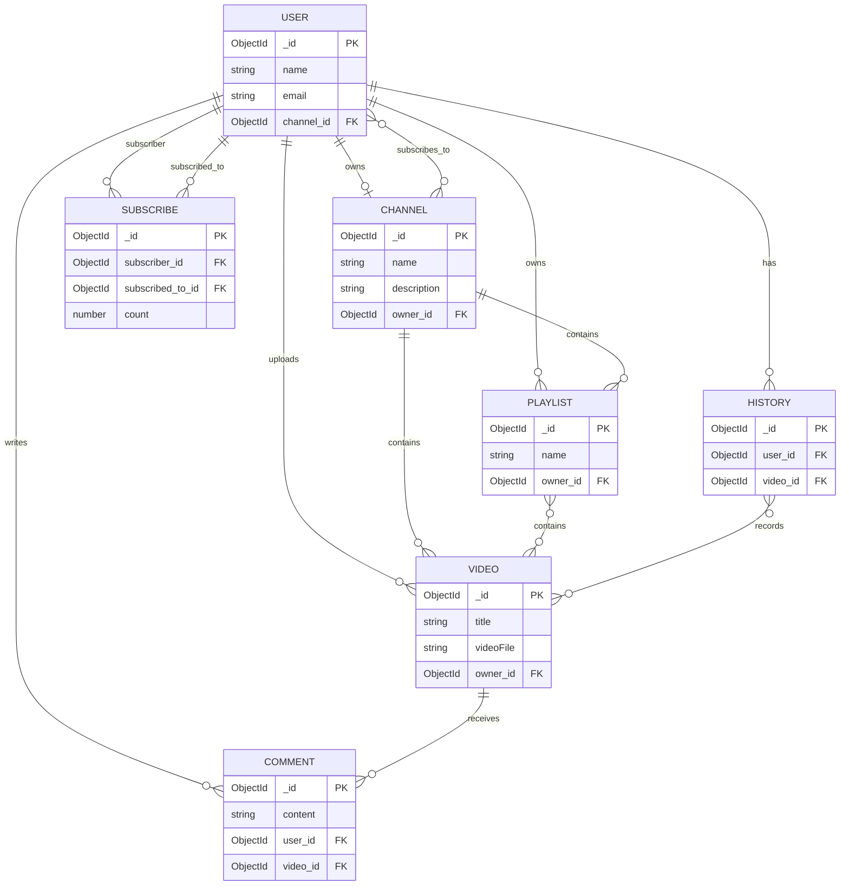

# Model Relationships

This diagram summarizes the conceptual relationships among the Mongoose models in `src/db/models`.

## Notes

- Mongoose `ref` values identify related documents; they are not database-enforced foreign keys. The `FK` labels above are diagram notation only.
- The diagram consolidates paired references into conceptual relationships. For example, `User.channel` and `Channel.owner` describe channel ownership; `Channel.videos` and `Video.owner` describe the channel's videos and their uploader.
- Some schema fields store references as arrays even where the conceptual relationship is singular per document. In particular, `Comment.videoId` and `Comment.userId` are arrays, while the diagram shows each comment as written by one user and attached to one video. `History.videoId` is also an array, represented as a history record containing multiple videos.
- Subscriptions appear in both `Channel.subscribers` and `Subscribe` (which links one user to another). Both representations are shown because they are distinct references in the current schemas.

## Relationship pros and trade-offs

The reference-based design keeps related documents independent: users can own channels and playlists, upload videos, write comments, build viewing history, and create subscriptions without embedding entire related documents inside one another. This makes each model easier to update and lets the same video be referenced by multiple playlists or history records. The trade-off is that a relationship often needs extra lookups or Mongoose `populate()` calls, and `ref` fields do not enforce that referenced documents exist or remain synchronized. The mirrored ownership and membership references (such as `User.channel` with `Channel.owner`, or `Channel.videos` alongside each `Video.owner`) can make navigation convenient from either side, but updates must keep both sides consistent.

The diagram also models useful one-to-many and many-to-many cases: a user can upload many videos and write many comments, while playlists can contain many videos and videos can appear in many playlists. The `Subscribe` model represents a user-to-user subscription edge, while `Channel.subscribers` is a separate user list; keeping both can support different query patterns, but creates duplicate subscription state that can diverge. Arrays such as `Comment.videoId`/`userId` and `History.videoId` allow multiple references per document, but the comment arrays differ from the usual one-author/one-video interpretation and history arrays can grow large. These choices offer flexibility and fewer rigid joins, at the cost of validation, consistency, and potentially larger or slower reads as the referenced arrays grow.
